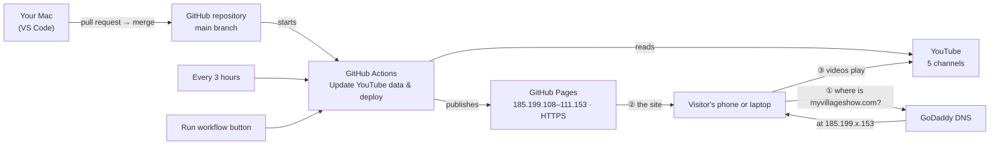
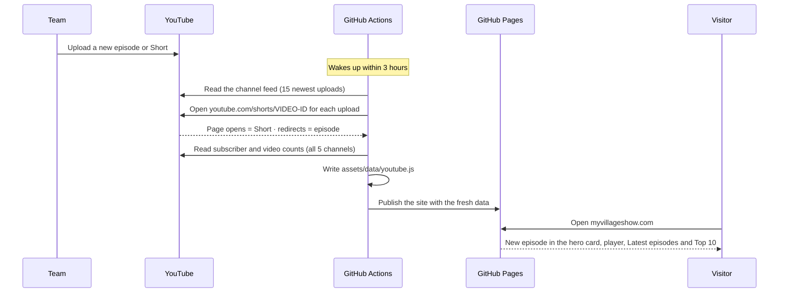

# myvillageshow.com

Official website of **My Village Show**, the first village-based Telugu YouTube channel (Lambadipally, Telangana, since 2012).

- **Live site:** https://myvillageshow.com
- **Stack:** plain HTML, CSS and JavaScript, with no build step
- **Hosting:** GitHub Pages (free, HTTPS included). The domain is registered at GoDaddy.
- **YouTube data:** refreshed automatically every 3 hours

---

## How it works, end to end



| Piece | What it does |
|---|---|
| **GitHub repository** | Stores every file and the full history, so any change can be undone. |
| **GitHub Actions** | The robot in [`.github/workflows/deploy.yml`](.github/workflows/deploy.yml). It refreshes the YouTube data and publishes the site. |
| **GitHub Pages** | Hosts the site on GitHub's servers, with the HTTPS padlock. |
| **GoDaddy DNS** | The address book. `myvillageshow.com` points to GitHub's servers (4 `A` records), and `www` is a `CNAME` to `sriramsrikanth05-hash.github.io`. |
| **YouTube** | Source of the episodes, Shorts and subscriber counts. Videos stream from YouTube, not from GitHub. |

The robot runs:
1. after every merge into `main`;
2. every 3 hours by itself, at 17 minutes past 00:00, 03:00, 06:00… UTC;
3. whenever someone presses **Actions → Update YouTube data & deploy → Run workflow**.

Only `index.html`, `assets/` and `CNAME` are published. `tools/`, this README and the workflow are not.

---

## How a new video reaches the site by itself

Nobody has to do anything. After the team uploads to the main **@MyVillageShow** channel:



| Step | Time |
|---|---|
| Upload on YouTube | any time |
| Robot wakes up | within 3 hours |
| Read the channel feed and sort episodes from Shorts | about 20 seconds |
| Publish the site | about 30 seconds |

- **Episodes** go to the hero card, the main player and *Latest episodes* (up to 9).
- **Shorts** go to the *Shorts* row (up to 9).
- The **Top 10** ranks episodes and Shorts together by views.
- New videos come from the **main My Village Show channel only**. The other four channels supply their subscriber and video counts.
- **Podcast episodes** are picked up from **all five channels**: each channel's "podcast" search and newest uploads, plus the official *My Village Show Podcast* playlist. Only full episodes (20+ minutes) are kept, so Shorts and clips are skipped.
- **To publish a new upload right away:** Actions → *Update YouTube data & deploy* → **Run workflow**. It's live in about a minute.
- **If YouTube can't be reached**, the site keeps the copy of `assets/data/youtube.js` stored in the repository, so it never breaks.

### What updates by itself, and what needs a change

| Automatic, every 3 hours | Needs a pull request |
|---|---|
| New episodes and Shorts | Text: story, about, HRDC, press quotes |
| View counts and the Top 10 | Team photos and press clippings |
| Subscriber and video counts for all 5 channels | Adding or removing a channel (`CHANNELS` in [`tools/update_youtube.py`](tools/update_youtube.py)) |
| Hero totals (subscribers, videos, channels) | The "1.1B+ views" figure |
| Channel profile pictures | Colors, fonts and layout |

---

## Making a change

`main` is protected. **Nobody can push to it directly**, admins included, so every change goes through a pull request.

```sh
git checkout main && git pull
git checkout -b my-change          # 1. new branch
# ...edit files, preview locally (see below)...
git add -A && git commit -m "Describe the change"
git push -u origin my-change       # 2. push the branch
gh pr create --fill                # 3. open a pull request
gh pr merge --squash --delete-branch   # 4. merge, and the site goes live in about a minute
```

You can also open and merge the pull request on github.com.

### Preview locally

    python3 -m http.server 8080

Then open http://localhost:8080.

### Where things are

| To change | Edit |
|---|---|
| Text, team, story, HRDC, press, contact details | `index.html` |
| Colors, fonts, layout, animations | `assets/style.css`. Colors are defined once at the top: the **palette**, the **roles** that use it, and the **tones** (orange = brand, red = YouTube, green = community/HRDC, gold = press). |
| Interactive behavior (player, rows, counters) | `assets/main.js` |
| Images | `assets/img/` |
| Which YouTube channels are shown | `CHANNELS` in `tools/update_youtube.py` |

To refresh the stored YouTube data by hand: `python3 tools/update_youtube.py`.

---

## Domain setup (already done, for reference)

GoDaddy → myvillageshow.com → DNS (nameservers: GoDaddy default):

| Type | Name | Value |
|---|---|---|
| A | @ | 185.199.108.153 |
| A | @ | 185.199.109.153 |
| A | @ | 185.199.110.153 |
| A | @ | 185.199.111.153 |
| CNAME | www | sriramsrikanth05-hash.github.io |

GitHub → repository **Settings → Pages**: Source = *GitHub Actions*, custom domain = `myvillageshow.com`, **Enforce HTTPS** on.

### myvillageshow.in (mirror)

myvillageshow.in shows the same site. GitHub Pages allows only one custom domain per repository, so the last step of the workflow pushes the same build to [`myvillageshow-in`](https://github.com/sriramsrikanth05-hash/myvillageshow-in), with `CNAME` set to `myvillageshow.in`. Both domains update together: on every merge, every 3 hours, and on **Run workflow**. Never edit `myvillageshow-in` by hand. Each run overwrites it.

- The push uses the `MIRROR_DEPLOY_KEY` secret in this repository. Its public half is a deploy key with write access on `myvillageshow-in`.
- The page's canonical link points to `https://myvillageshow.com/`, so Google treats .com as the main address and doesn't count .in as duplicate content.
- `myvillageshow-in` → **Settings → Pages**: Source = *Deploy from a branch* (`main`, `/`), custom domain = `myvillageshow.in`, **Enforce HTTPS** on.

The domain is registered at GoDaddy. Its DNS must keep the Google Workspace email records (MX and the `google-site-verification` TXT) for srikanth@myvillageshow.in:

| Type | Name | Value |
|---|---|---|
| A | @ | 185.199.108.153 |
| A | @ | 185.199.109.153 |
| A | @ | 185.199.110.153 |
| A | @ | 185.199.111.153 |
| CNAME | www | sriramsrikanth05-hash.github.io |
| MX | @ | 10 aspmx.l.google.com |
| MX | @ | 20 alt1.aspmx.l.google.com |
| MX | @ | 30 alt2.aspmx.l.google.com |
| MX | @ | 40 alt3.aspmx.l.google.com |
| MX | @ | 50 alt4.aspmx.l.google.com |
| TXT | @ | google-site-verification=Rmc-7bpP7ZZv8s_P-s3HEzFOAFKK7cRQnxXGdLP-w-4 |
